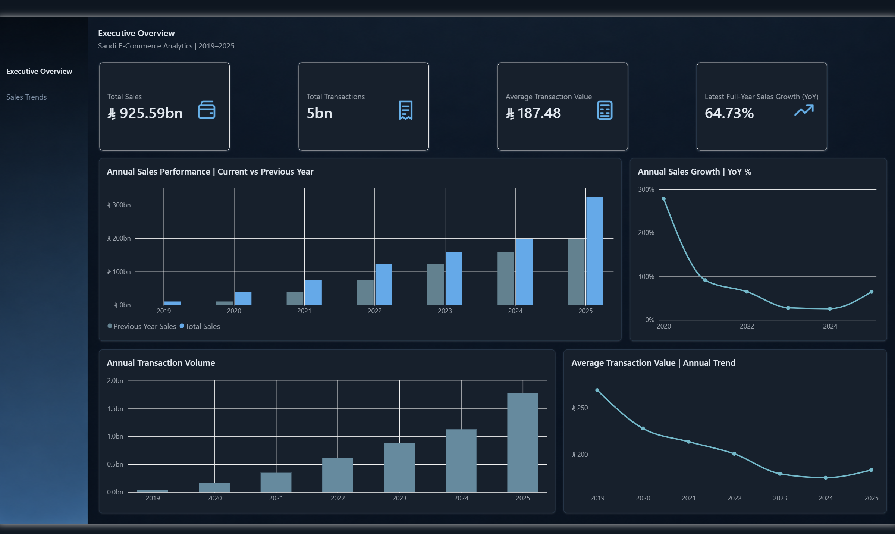
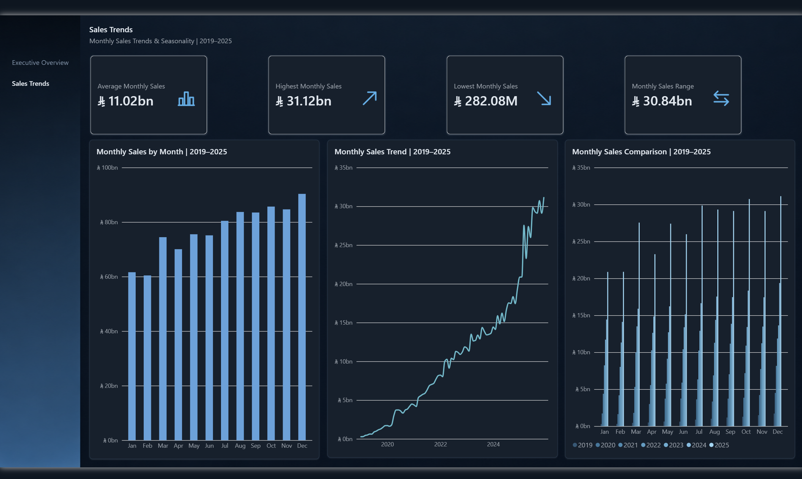

# Saudi E-Commerce Sales Analytics

**Power BI | Sales Performance & Trend Intelligence**

An interactive Power BI report exploring Saudi e-commerce sales and transaction trends across **2019–2025**. The analysis focuses on completed calendar years; partial 2026 records are retained in the source data but excluded from the published report views.

## The Challenge

Annual totals alone can hide important shifts in transaction activity, average transaction value, and month-to-month sales performance. This project brings those measures together in a consistent, easy-to-navigate reporting experience.

## The Dashboard Experience

### 01 — Executive Overview

A high-level view of total sales, total transactions, average transaction value, and year-over-year sales growth, supported by annual performance and transaction charts.



### 02 — Sales Trends

A closer look at average, highest, and lowest monthly sales, monthly sales range, monthly sales movement, seasonality, and comparisons across years.



## Analytical Approach

- **Data modeling:** A calendar table linked to monthly transaction records.
- **DAX measures:** Sales totals, transaction totals, average transaction value, year-over-year growth, and monthly sales statistics.
- **Time-series analysis:** Annual and monthly views, including month-of-year comparisons.
- **Reporting scope:** 2019–2025, excluding incomplete 2026 data from report-level analysis.

## Tools

**Power BI Desktop · Power Query · DAX · Data Modeling**

## Repository Structure

```text
Saudi-Ecommerce-Sales-Analytics/
├── README.md
├── dashboard/
│   └── Saudi_Ecommerce_Sales_Analytics.pbix
└── assets/
    ├── 01_Executive_Overview.png
    └── 02_Sales_Trends.png
```

## Explore the Report

Open [`dashboard/Saudi_Ecommerce_Sales_Analytics.pbix`](dashboard/Saudi_Ecommerce_Sales_Analytics.pbix) in Power BI Desktop to explore the report. The screenshots above provide a preview without requiring Power BI.

---

**Designed & Developed by Dana Alhazmi**  
[GitHub](https://github.com/danalhazmi)
