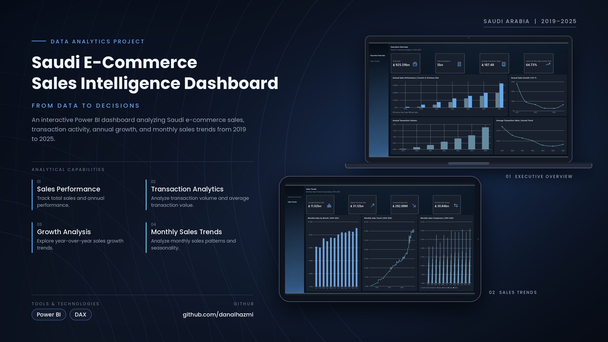

<p align="center">
  
</p>

<h1 align="center">SAUDI E-COMMERCE SALES ANALYTICS</h1>

<p align="center">
  <strong>Sales Performance & Transaction Intelligence</strong>
</p>

<p align="center">
  An interactive Power BI solution for analyzing Saudi e-commerce sales, transaction activity, annual growth, and monthly sales trends from 2019 to 2025.
</p>

<p align="center">
  <a href="https://app.powerbi.com/view?r=eyJrIjoiZDlkZTA2NzItNDc0MC00ZDhhLTk4M2ItZjMxY2NjODdiMDA0IiwidCI6IjJkMzE5NGUzLTE2NTQtNDZiZC1iYWUyLWFkMzdiYTExYjBhZSIsImMiOjl9">
    <strong>VIEW INTERACTIVE DASHBOARD →</strong>
  </a>
</p>

<p align="center">
  <strong>SAR 925.59bn</strong> Sales &nbsp;&nbsp;·&nbsp;&nbsp;
  <strong>5bn</strong> Transactions &nbsp;&nbsp;·&nbsp;&nbsp;
  <strong>SAR 187.48</strong> Average Transaction Value &nbsp;&nbsp;·&nbsp;&nbsp;
  <strong>64.73%</strong> Latest Full-Year Growth
</p>

<br>

---
## 01 | THE CHALLENGE

Sales totals alone do not explain how e-commerce activity changes over time. Transaction volume, average transaction value, year-over-year growth, and monthly fluctuations provide important context for interpreting overall performance.

The challenge was to bring these measures into one consistent reporting experience, making it easier to compare annual results and examine monthly sales patterns without switching between separate analyses.

The analysis focuses on three questions:

1. How have sales and transaction volumes changed across the reporting period?
2. How do average transaction values and annual growth rates evolve over time?
3. What monthly sales patterns and variations appear across different years?

<br>

---

## 02 | ANALYTICAL SCOPE

The report is organized into two views, each focusing on a different level of sales analysis. The published reporting period is **2019–2025**; incomplete 2026 data is excluded from the report views.

| Area | Analysis |
|---|---|
| **Executive Overview** | Total sales, transaction volume, average transaction value, annual sales comparisons, and year-over-year growth |
| **Sales Trends** | Average, highest, and lowest monthly sales; monthly sales range; monthly trends; and comparisons across years |

<br>

---

## 03 | DASHBOARD

### Executive Overview

A high-level view of sales performance and transaction activity, supported by annual comparisons and growth trends.

<p align="center">
  
</p>

<br>

### Sales Trends

A closer look at monthly sales levels, variation, and historical patterns across the reporting period.

<p align="center">
  
</p>

<br>

---

## 04 | KEY FINDINGS

Across **2019–2025**, the report displays **SAR 925.59bn** in total sales and approximately **5bn transactions**, with an overall **average transaction value of SAR 187.48**.

The latest complete year shows **64.73% year-over-year sales growth**. Annual sales and transaction charts provide context for how the reported totals changed throughout the period.

Monthly analysis identifies a **highest monthly sales value of SAR 31.12bn** and a **lowest monthly sales value of SAR 282.08M**, representing a displayed **monthly sales range of SAR 30.84bn**. The monthly views allow users to examine the progression and variation of sales across years.

<br>

---

## 05 | DATA MODEL & DAX

The Power BI report uses a dedicated **Calendar** table with defined relationships to support annual and monthly analysis. DAX measures provide the calculations displayed in KPI cards and charts.

The report includes measures for:

- Total Sales
- Total Transactions
- Average Transaction Value
- Latest Full-Year Sales Growth (YoY)
- Previous-Year Sales and Annual Sales Growth
- Average Monthly Sales
- Highest and Lowest Monthly Sales
- Monthly Sales Range

The calendar-based analysis supports comparisons across years and months. The report views focus on complete calendar years from **2019 through 2025**.

<br>

---

## 06 | PROJECT STRUCTURE

```text
Saudi-Ecommerce-Sales-Analytics/
│
├── assets/
│   ├── Saudi_Ecommerce_Analytics_Banner.png
│   ├── 01_Executive_Overview.png
│   └── 02_Sales_Trends.png
│
├── dashboard/
│   └── Saudi_Ecommerce_Sales_Analytics.pbix
│
└── README.md
```

<br>

---

<p align="center">
  <strong>Designed & Developed by Dana Alhazmi</strong>
</p>

<p align="center">
  Data Modeling · Analytics · Dashboard Architecture · Visual Design
</p>
